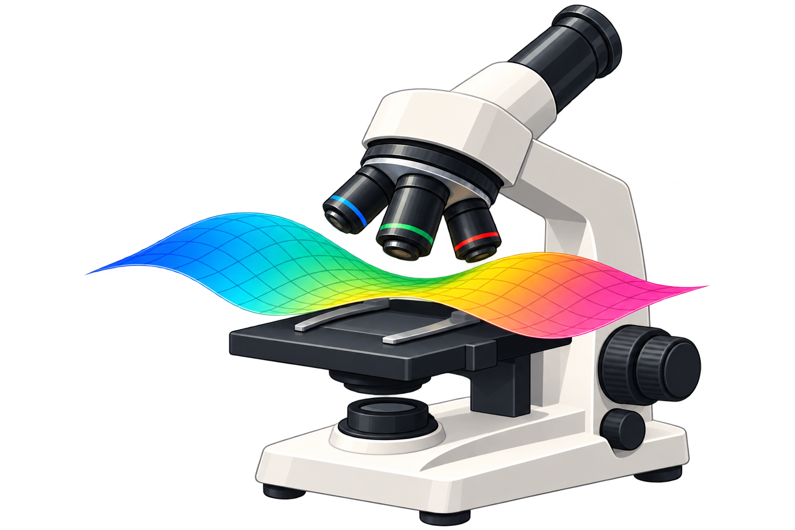

# The Data Manifold under the Microscope

`manifold-microscope` provides toy and image datasets, plus finite-difference estimates of volume, scalar curvature and reach on parameter grids. It accompanies [Marios Koulakis and Constantin Seibold, *The Data Manifold under the Microscope* (ICML 2026)](https://proceedings.mlr.press/v306/koulakis26a.html).

## Install 

Python ≥3.10:

```bash
python -m pip install manifold-microscope
```

For the experiment scripts:

```bash
python -m pip install "manifold-microscope[benchmark]"
```

## Quickstart: scalar curvature on a sphere

```python
import numpy as np
from microscope.computations_grid.curvature import scalar_curvature

radius = 2.0
latitude = np.linspace(-0.7, 0.7, 41)  # Avoid the coordinate singularities at the poles.
longitude = np.linspace(0, 2 * np.pi, 48, endpoint=False)
u, v = np.meshgrid(latitude, longitude, indexing="ij")
points = radius * np.stack(
    [np.cos(u) * np.cos(v), np.cos(u) * np.sin(v), np.sin(u)], axis=-1
)
curvature = scalar_curvature(
    points,
    difference_intervals=[latitude[1] - latitude[0], longitude[1] - longitude[0]],
    cyclic_dimensions=[1],
    patch_sizes=[13, 17],
    device="cpu",
)
print(f"Mean scalar curvature: {curvature.mean():.3f}")
# Approximately 0.5: a sphere has scalar curvature 2 / radius**2.
```

Grid APIs with a `device` argument select CUDA when available, otherwise CPU.
Custom experiment configs default to CPU; the paper presets explicitly request
`cuda:0` and fail if it cannot initialize. See the [experiment guide](docs/source/guide/experiments.rst)
for device overrides, training budgets, progress controls and output formats.

## Documentation and paper reproduction

- [Documentation index](docs/source/index.rst)
- [Getting started](docs/source/guide/getting_started.rst) and [API reference](docs/source/api_reference/geometry.rst)
- [Paper reproduction](docs/source/guide/reproducibility.rst)
- [Configuration and defaults](docs/source/guide/configuration.rst)
- [Outputs and reuse](docs/source/guide/outputs.rst)
- [Build and publish the docs](docs/source/guide/building.rst)
- [Dataset and geometry notebooks](notebooks/datasets_and_measures)

**Note:** The original paper experiments were not fully seeded. Current presets
specify seeds, but plots may still vary slightly across runs or devices.

[BSD-3-Clause license](LICENSE); adapted β-VAE code has a separate [MIT attribution and license](docs/source/third_party/beta_vae.rst).

## Citation

If you use our code in your work, please cite our paper:

```bibtex
@InProceedings{pmlr-v306-koulakis26a,
  title     = {The Data Manifold under the Microscope},
  author    = {Koulakis, Marios and Seibold, Constantin},
  booktitle = {Proceedings of the 43rd International Conference on Machine Learning},
  pages     = {60568--60602},
  year      = {2026},
  volume    = {306},
  series    = {Proceedings of Machine Learning Research},
  publisher = {PMLR},
  url       = {https://proceedings.mlr.press/v306/koulakis26a.html}
}
```
